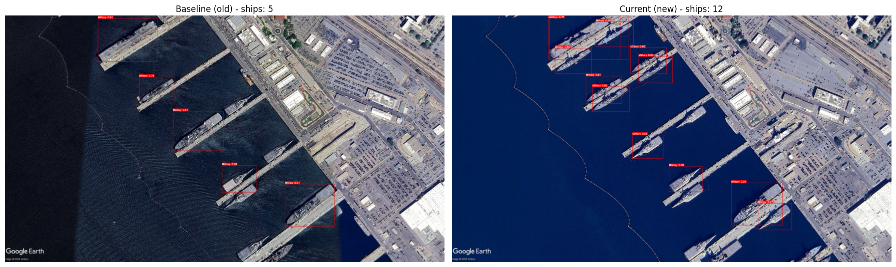
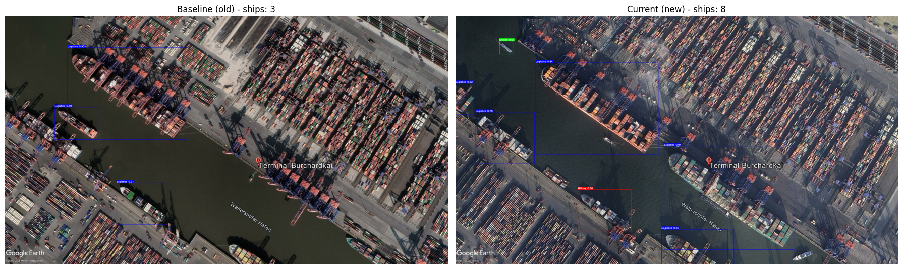

# Ship-Detection-DS
Satellite-based ship detection and monitoring tool that separates **military** from **logistics** vessels, built on YOLOv8.

## Project Overview
The goal of this project is an automated pipeline that detects maritime vessels in satellite and aerial imagery and classifies them as military or logistics ships. This bridges commercial logistics tracking with strategic security monitoring. A third category, **civilian**, was added in version 2 to capture all remaining vessel types (ferries, yachts, fishing boats, ...).

By comparing images of the same location at two points in time, the system reports which ships appeared or disappeared (change detection).

## The Data-Centric Approach
The core milestone of this project was shifting from model tuning to a Data-Centric AI approach:
* **Version 1 (Baseline):** Suffered from extreme over-granularity with 25 specific ship classes, leading to massive label noise and high intra-class confusion.
* **Version 2 (Optimized):** Consolidated the classes into 3 core categories (`civilian`, `logistics`, `military`) and combined this with rigorous manual dataset cleaning and bounding box refinement. This stabilized training and yielded 71% mAP50 overall.

### Results (V2, YOLOv8s, validation set: 548 images, 2560 instances)
| Class | Precision | Recall | mAP50 | mAP50-95 |
|---|---|---|---|---|
| all | 0.757 | 0.718 | 0.713 | 0.551 |
| civilian | 0.554 | 0.586 | 0.444 | 0.240 |
| logistics | 0.868 | 0.628 | 0.748 | 0.602 |
| military | 0.849 | 0.939 | 0.947 | 0.813 |

`military` is detected very reliably. `civilian` is the weakest class: it is the most heterogeneous category and the least represented in the original task, so expect more misses there. Training curves and confusion matrices are in [docs/plots](docs/plots).

## Core Features
* **Change detection:** Compares a baseline and a current image and reports ships that were added or disappeared per category.
* **Directory scanning (batch screening):** Processes every image in a target folder autonomously.
* **Negative-filter logic:** Frames containing only empty ocean are identified and skipped in the report.
* **Standardized rendering:** Detections above the confidence threshold are drawn with color-coded boxes (military = red, logistics = blue, civilian = green) and confidence scores.

### Example: change detection
Military surveillance (San Diego) and logistics tracking (Hamburg), baseline vs. current image:

> Satellite imagery: © Google Earth / Airbus, Maxar and other providers. Shown for demonstration purposes only; all rights remain with the respective owners.




## Repository Structure
```
notebooks/
  v1_train_model.ipynb          V1 training (25 classes, YOLO11n, local CPU)
  v1_inference_analysis.ipynb   V1 inference on a single image
  v2_training_colab.ipynb       V2 training (3 classes, YOLOv8s, Google Colab GPU)
  v2_inference_analysis.ipynb   V2 inference on a random test image
  ship_detection_system.ipynb   Main system: change detection + batch screening
models/final_weights/           V2 model weights (v2_3classes_best.pt)
src/mapping.py                  Class -> category mapping, colors, categorize()
docs/plots/                     Training curves and confusion matrices (v1, v2)
docs/examples/                  Example outputs of the change detection
configs/v1_data.yaml            Dataset config of the V1 dataset (25 classes)
```

## Getting Started
1. Install the dependencies: `pip install -r requirements.txt`
2. The V2 model weights are included at `models/final_weights/v2_3classes_best.pt`. Training data and other weights are not part of the repository (see `.gitignore`); download the dataset from Roboflow (see below) into `data/processed/ship_data` if you want to retrain or evaluate.
3. Open `notebooks/ship_detection_system.ipynb` and run the cells.

For the change detection scenarios put a pair of images per location into the test image folder (`<name>_old.jpg` and `<name>_new.jpg`) and adjust the `scenarios` dictionary. For batch screening drop your images into `data/processed/ship_data/test/batch_screening`.

To retrain V2, open `notebooks/v2_training_colab.ipynb` in Google Colab, add your Roboflow API key as a Colab secret named `ROBOFLOW_API_KEY` (key icon in the left sidebar, enable notebook access) and run the notebook. Outside of Colab, set the `ROBOFLOW_API_KEY` environment variable instead. Note that the notebook downloads the cleaned dataset from the author's own Roboflow workspace; to retrain on your own data, change the workspace, project and version in the download cell.

## Data
The base dataset is the [Ship Detection dataset on Roboflow Universe](https://universe.roboflow.com/playground-v6gip/ship-detection-mdpqd/dataset/2) (MIT license). The V2 dataset is a manually cleaned and consolidated 3-class derivative of it.

## License
The code is released under the [MIT License](LICENSE).
